# Ajolotito Hambriento — Evidencia de TDD por rondas

Ajolotito Hambriento es una mascota virtual (un ajolote) cuya hambre sube con el tiempo; la app avisa con notificaciones locales cuando tiene hambre. El proyecto en Flutter se construyó con TDD siguiendo el *Manual paso a paso con TDD: Ajolotito Hambriento* (Desarrollo Móvil Integral, UTNG). El juego es el pretexto: lo que se practica es cómo hacer bien las notificaciones (permisos en contexto, canales, programación sin duplicados, horas de silencio y toques sobre el aviso).

Las capturas de cada ronda están en la carpeta [`capturas/`](capturas/).

## Cómo leer las capturas

En cada ronda con lógica se siguió el ciclo de TDD:

1. 🔴 **Rojo:** se agregó primero el archivo de pruebas y se ejecutó `flutter test test\<archivo>`; falla porque el código todavía no existe (errores como `Error when reading 'lib/...'`, `Undefined name` o `Method not found`).
2. 🟢 **Verde:** se agregó el código mínimo y se volvió a ejecutar hasta ver `All tests passed!`. El contador (`+N`) es el número de pruebas de ese archivo.

## Resumen

| Ronda | Tema | Archivo de pruebas | Resultado en verde |
|-------|------|--------------------|--------------------|
| 1 | Preparar el proyecto | — | sin pruebas todavía |
| 2 | El reloj y el ajolote | `mascota_test.dart` | `+16` |
| 3 | Categorías, canales y mensajes | — (código de apoyo) | — |
| 4 y 5 | Política de buena educación y payload | `politica_payload_test.dart` | `+12` |
| 6 | El planificador | `planificador_test.dart` | `+13` |
| 7 | El puerto (aislar el plugin) | — (puerto y doble de pruebas) | — |
| 8 | El permiso | `permiso_test.dart` | `+6` |
| 9 | El servicio | `servicio_test.dart` | `+14` |
| 10 | El adaptador real | — (código del plugin real) | — |
| 11a | ViewModel | `vm_test.dart` | `+10` |
| 11b | Pantallas | `pantalla_test.dart` | `+3` |
| — | Todas las pruebas juntas | los 7 archivos | `+74` |

Las rondas 0 (los diez mandamientos de una notificación), 12 (probar en un teléfono) y 13 (notificaciones push) no producen código con pruebas automáticas, por lo que no tienen capturas de rojo/verde.

## Rondas

### Ronda 1 — Preparar el proyecto

Se creó el proyecto con `flutter create ajolotito`, se sustituyó el `pubspec.yaml` (con `flutter_local_notifications`, `timezone`, `shared_preferences` y `app_settings`) y se ejecutó `flutter pub get`. Como todavía no hay pruebas, `flutter test` avisa que el directorio `test` no contiene archivos de prueba, que es lo esperado en este punto.

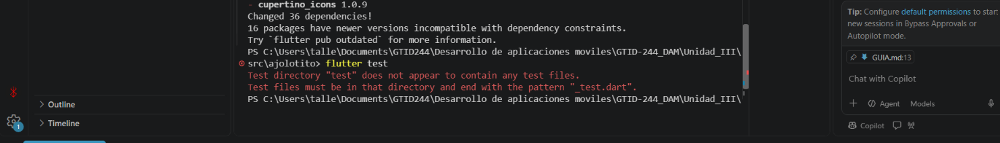

### Ronda 2 — El reloj y el ajolote

El reloj se trata como dependencia para controlar el tiempo en las pruebas. Se prueban la saciedad (baja 10 puntos por hora y nunca por debajo de 0), el humor con pruebas de frontera, la predicción de cuándo tendrá hambre, alimentar y guardar/recuperar el estado.

Archivo de pruebas: `test/mascota_test.dart`

🔴 **Rojo** — la prueba falla porque el código aún no existe (`capturas/r02_rojo.png`)

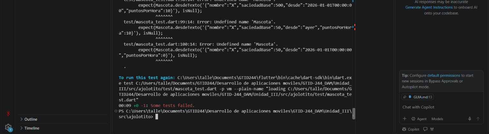

🟢 **Verde** — `+16: All tests passed!` (`capturas/r02_verde.png`)

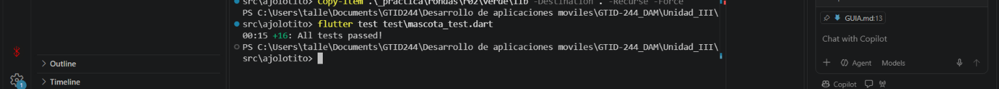

### Ronda 3 — Categorías, canales y mensajes

Esta ronda no tiene pruebas propias: agrega `categoria.dart` y `mensajes.dart`, que usan las rondas siguientes.

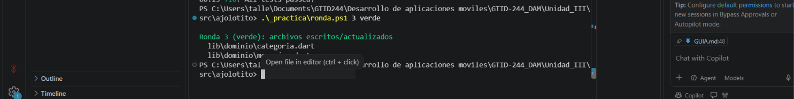

### Ronda 4 y 5 — La política de buena educación y el payload

Se prueban las horas de silencio (de 22:00 a 08:00, cruzando la medianoche), mover un aviso al final del silencio (incluido el cambio de mes) y el payload versionado, que ante datos raros siempre cae en el inicio sin tronar. El payload (Ronda 5) se cubre en el mismo archivo de pruebas.

Archivo de pruebas: `test/politica_payload_test.dart`

🔴 **Rojo** — la prueba falla porque el código aún no existe (`capturas/r04_rojo.png`)

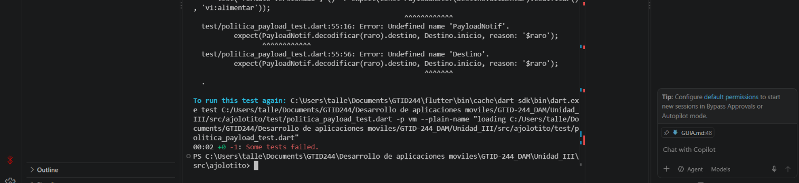

🟢 **Verde** — `+12: All tests passed!` (`capturas/r04_verde.png`)

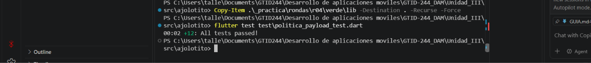

### Ronda 6 — El planificador

Función pura que recibe al ajolote y la hora actual y devuelve la lista de avisos que deberían estar programados.

Archivo de pruebas: `test/planificador_test.dart`

🔴 **Rojo** — la prueba falla porque el código aún no existe (`capturas/r06_rojo.png`)

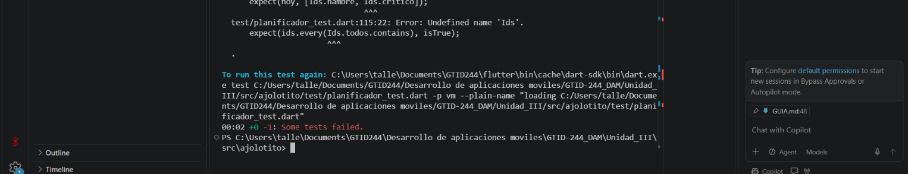

🟢 **Verde** — `+13: All tests passed!` (`capturas/r06_verde.png`)

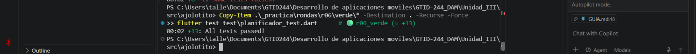

### Ronda 7 — El puerto

Sin pruebas propias: se agrega `puerto.dart` (la interfaz que aísla el plugin) y `test/falsos.dart` (el doble de pruebas que usarán las rondas 8, 9 y 11).

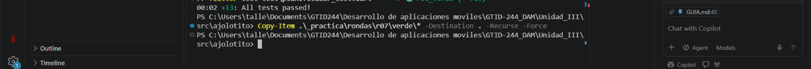

### Ronda 8 — El permiso

Pedir el permiso de notificaciones en el momento oportuno, una sola vez, y qué hacer cuando el usuario lo rechaza.

Archivo de pruebas: `test/permiso_test.dart`

🔴 **Rojo** — la prueba falla porque el código aún no existe (`capturas/r08_rojo.png`)

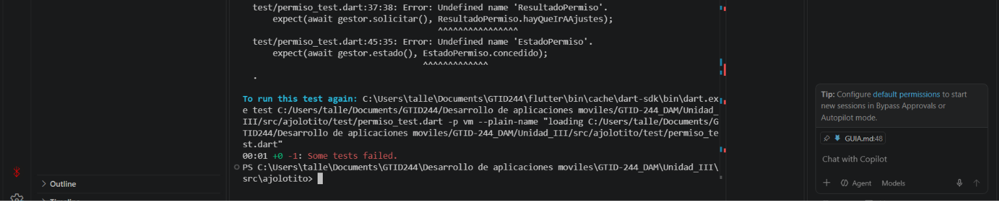

🟢 **Verde** — `+6: All tests passed!` (`capturas/r08_verde.png`)

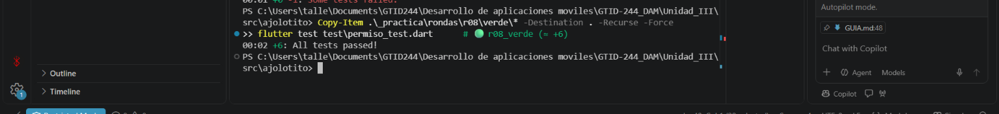

### Ronda 9 — El servicio

Mantiene sincronizados los avisos programados con el estado del ajolote: cancela y reprograma sin duplicados, respeta el permiso y el modo clase.

Archivo de pruebas: `test/servicio_test.dart`

🔴 **Rojo** — la prueba falla porque el código aún no existe (`capturas/r09_rojo.png`)

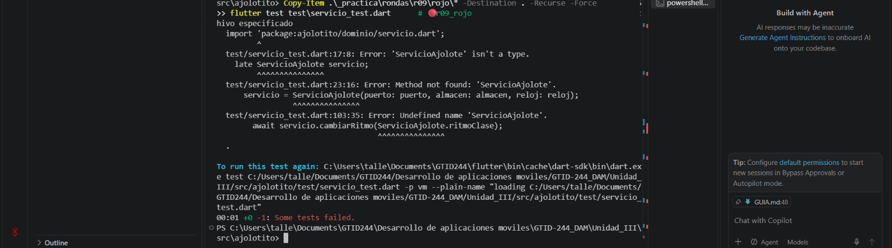

🟢 **Verde** — `+14: All tests passed!` (`capturas/r09_verde.png`)

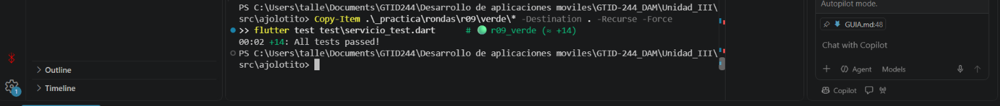

### Ronda 10 — El adaptador real

Sin pruebas automáticas: se agregan `infra/puerto_real.dart` (único archivo que conoce el plugin `flutter_local_notifications`) y `infra/almacen_prefs.dart`.

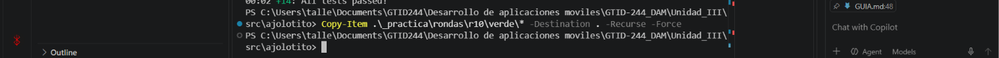

### Ronda 11 — ViewModel, pantallas y arranque

Esta ronda tiene dos ciclos de TDD.

#### 11a — ViewModel

El ViewModel conecta el servicio y el gestor de permiso con la interfaz.

Archivo de pruebas: `test/vm_test.dart`

🔴 **Rojo** — la prueba falla porque el código aún no existe (`capturas/r11a_rojo.png`)

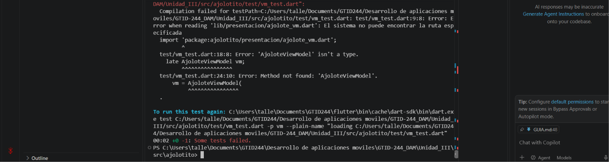

🟢 **Verde** — `+10: All tests passed!` (`capturas/r11a_verde.png`)

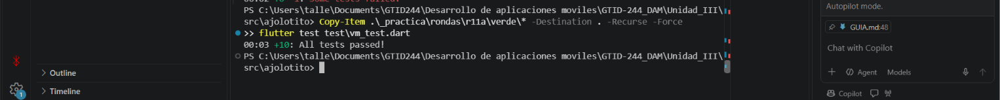

#### 11b — Pantallas

Pruebas de widgets de la pantalla del ajolote (por ejemplo, que dar de comer con hambre sube la saciedad y que el permiso se pide solo tras explicar y aceptar el diálogo).

Archivo de pruebas: `test/pantalla_test.dart`

🔴 **Rojo** — la prueba falla porque el código aún no existe (`capturas/r11b_rojo.png`)

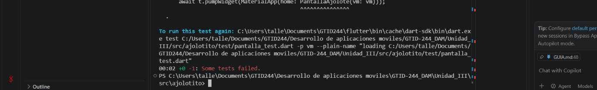

🟢 **Verde** — `+3: All tests passed!` (`capturas/r11b_verde.png`)

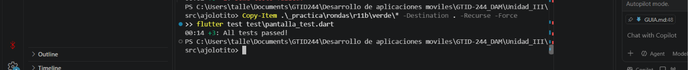

## Verificación final

Todas las pruebas juntas, y el detalle de cada una con el reporte expandido:

```
flutter test
flutter test --reporter expanded
```

🟢 `+74: All tests passed!`

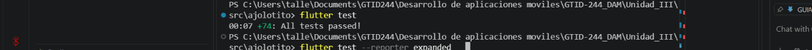

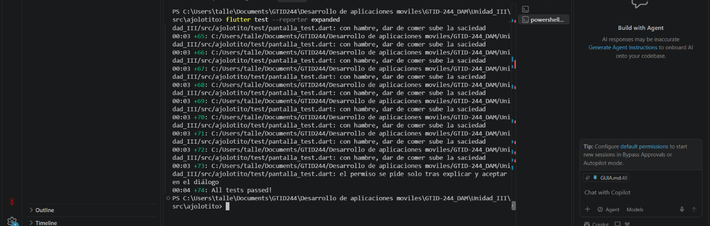

## La app en ejecución

Pantalla principal de la app: el ajolote Xólotl con su saciedad, el botón "Dar de comer", los próximos avisos programados, la opción de probar una notificación y el modo clase (1 hora = 1 minuto) para ver los avisos en minutos.

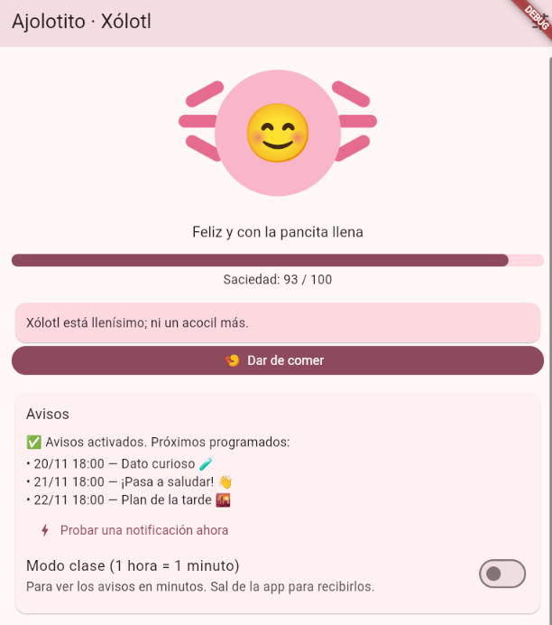

## Cómo ejecutar

```
flutter pub get
flutter test
flutter run
```
