# Habla Fluido

Aplicación móvil para aprender inglés con un tutor de IA. Entrena cinco habilidades (oído, pronunciación, lectura, escritura y conversación), reparte el tiempo diario según lo que más te cuesta y repasa las frases con repetición espaciada.

Se construyó con TDD: primero la prueba en ROJO, después el código en VERDE. Cada ronda del manual tiene su carpeta de pruebas y su evidencia en `docs/capturas/`.

## Requisitos

- Flutter estable (`flutter --version`)
- Windows con PowerShell, o Mac/Linux
- Chrome o Edge para la versión web
- Un teléfono Android con micrófono (para la voz real)
- Node.js 18 o superior (solo para el proxy de la IA, opcional)

## Ejecutar el proyecto

```powershell
cd habla_fluido
flutter pub get
flutter run -d chrome
```

Sin configurar nada, la app usa el **tutor simulado**: no necesita internet ni clave de API. Para usar la IA real:

```powershell
flutter run --dart-define=TUTOR_URL=https://tu-servidor.com/tutor
```

## Generar el APK

```powershell
flutter build apk --release
```

El archivo queda en `build\app\outputs\flutter-apk\app-release.apk`.

## Estructura

```
lib/
├── dominio/            Reglas puras: comparador, repaso SM-2, progreso, plan diario, tutor (contrato), voz (contrato)
├── datos/              Tutor simulado, tutor HTTP, voz real y simulada, almacenamiento
├── presentacion/
│   ├── vm/             ViewModels: aprendizaje, pronunciación, dictado, lectura, escritura, conversación, repaso
│   └── pantallas/      Interfaz: inicio, pronunciación, dictado, lectura, escritura, conversación, repaso
├── dependencias.dart   Raíz de composición (qué implementación se usa)
└── main.dart
proxy/                  Servidor Node.js que guarda la clave de la IA (opcional)
test/                   Pruebas por ronda
docs/capturas/          Evidencias de pruebas y de la app
```

El dominio no depende de Flutter, así que sus pruebas corren en consola, sin emulador.

## Rondas

| Ronda | Tema                                   | Estado                                  |
|-------|----------------------------------------|-----------------------------------------|
| 1     | Preparar el proyecto                   | Lista                                   |
| 2     | El comparador (pronunciación y oído)   | Lista (12 pruebas en verde)             |
| 3     | Repetición espaciada (SM-2)            | Lista (8 pruebas en verde)              |
| 4     | Progreso, nivel y plan diario          | Lista (12 pruebas en verde)             |
| 5     | Contenido y contrato del tutor         | Lista (archivos verificados)            |
| 6     | Proxy de la IA (Node.js)               | Lista (12 pruebas en verde)             |
| 7     | Tutor simulado y cliente HTTP          | Lista (17 pruebas en verde)             |
| 8     | Voz real y voz simulada                | Lista (verificada con análisis)         |
| 9     | ViewModels                             | Lista (29 pruebas en verde)             |
| 10    | Pantallas y raíz de composición        | Lista (app corre en Chrome)             |
| 11    | ¿Realmente están aprendiendo?          | Documento de diseño de evaluación       |

## Pruebas por ronda

Ejecuta cada prueba por separado. Todas deben terminar con `All tests passed!`.

Ronda 2 (comparador):

```powershell
flutter test test\comparador_test.dart
```

Ronda 3 (repaso espaciado):

```powershell
flutter test test\repaso_test.dart
```

Ronda 4 (progreso y plan diario):

```powershell
flutter test test\progreso_plan_test.dart
```

Ronda 6 (proxy de la IA, con Node.js):

```powershell
cd proxy
node --test
cd ..
```

Ronda 7 (tutor simulado y cliente HTTP):

```powershell
flutter test test\tutor_test.dart
```

Ronda 9 (ViewModels):

```powershell
flutter test test\vms_test.dart
```

Análisis del código:

```powershell
flutter analyze lib
```

## Capturas

### Ronda 2: comparador

Primer intento (ROJO): la prueba falla porque el código todavía no existe.

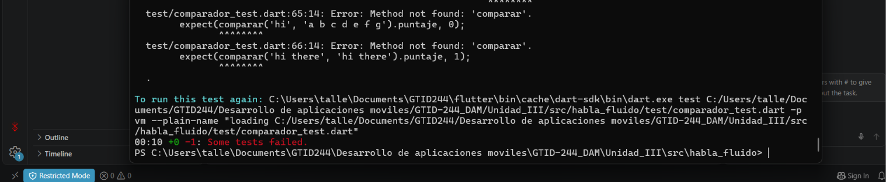

Las 12 pruebas en verde:

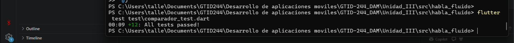
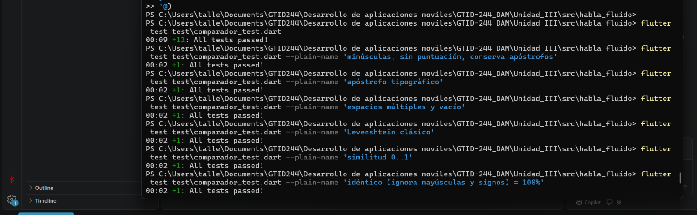
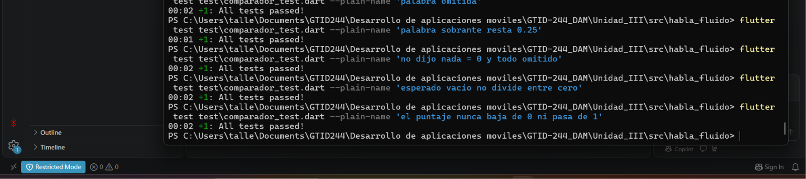

### Ronda 3: repaso espaciado

Primer intento (ROJO):

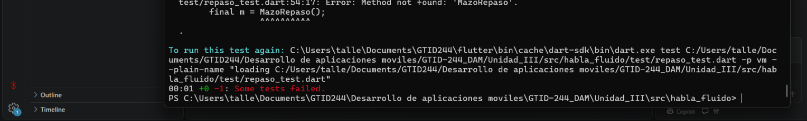

Las 8 pruebas en verde:

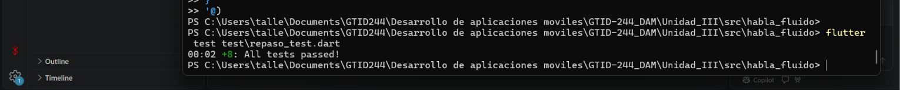
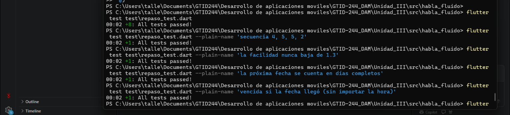
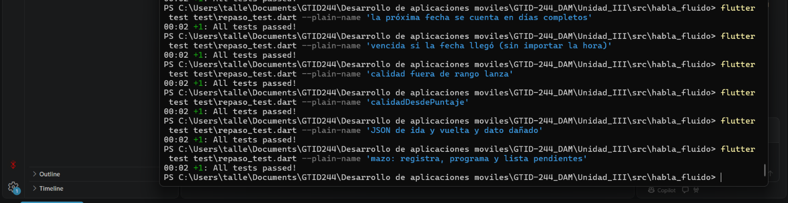

### Ronda 4: progreso y plan diario

Primer intento (ROJO):

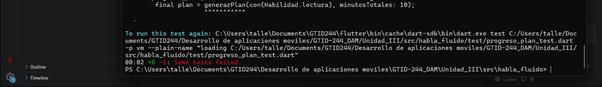

Las 12 pruebas en verde:

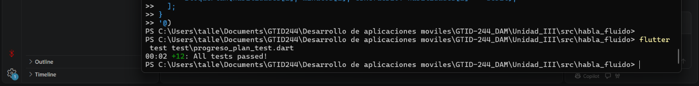
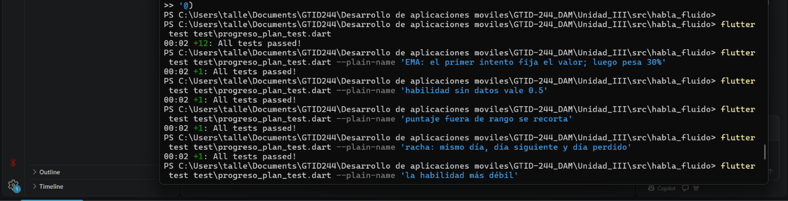
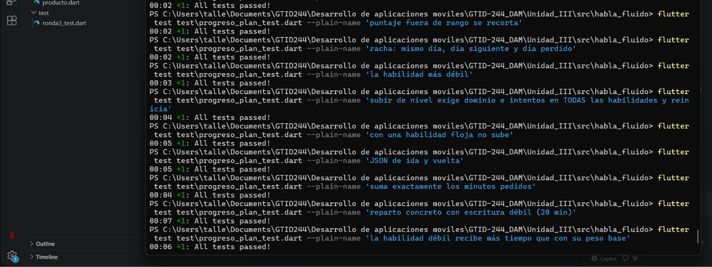

Análisis del dominio sin errores:

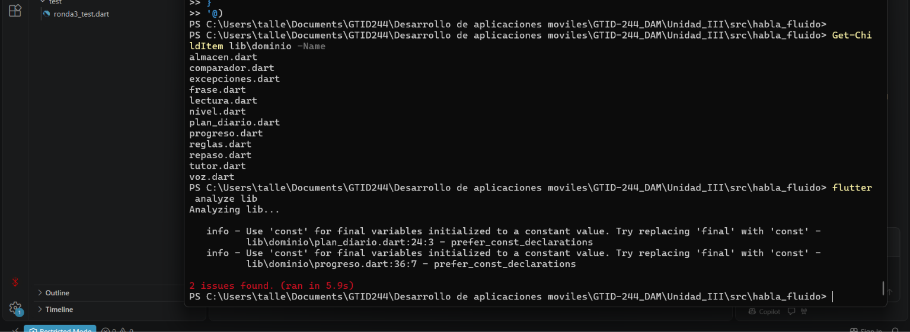

### Ronda 6: proxy de la IA

Primer intento, con la ruta de la carpeta incorrecta. Node no encontró el archivo de pruebas:

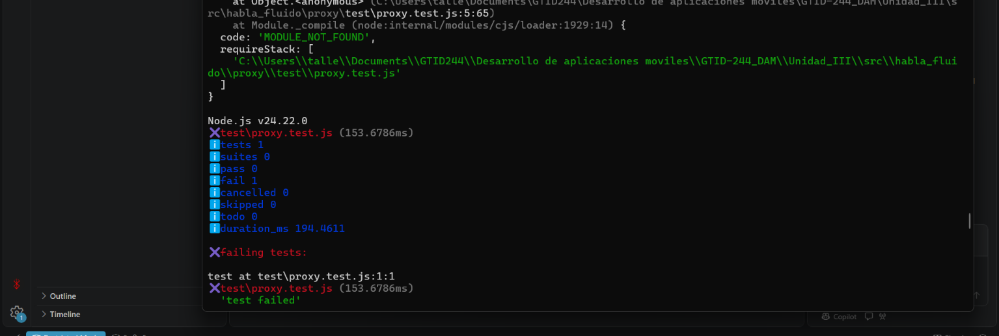

Las 12 pruebas en verde, ejecutadas desde la carpeta `proxy`:

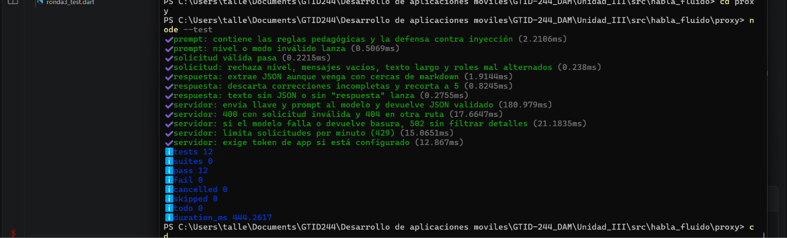

### Ronda 7: tutor simulado y cliente HTTP

Primer intento (ROJO), con errores de compilación:

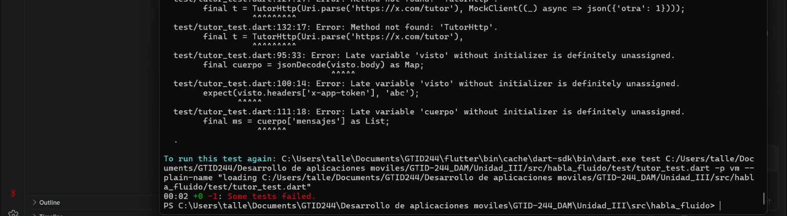
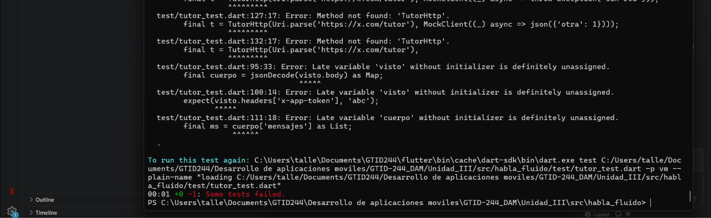

Las 17 pruebas en verde:

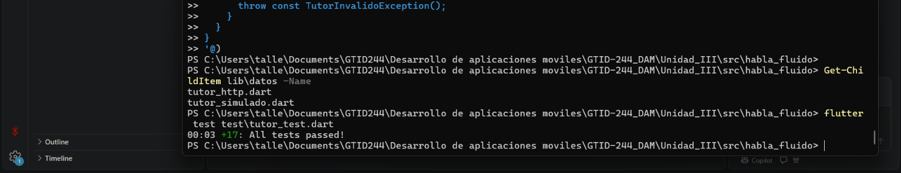

### Ronda 8: voz

Análisis con avisos de compatibilidad (no son errores):

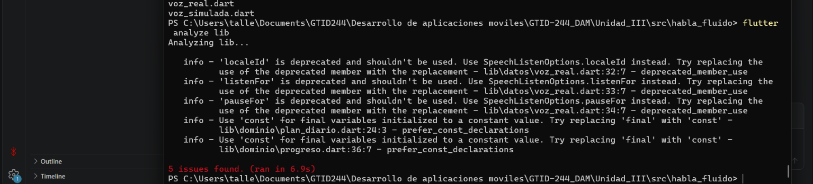

### Ronda 9: ViewModels

Las 29 pruebas en verde:

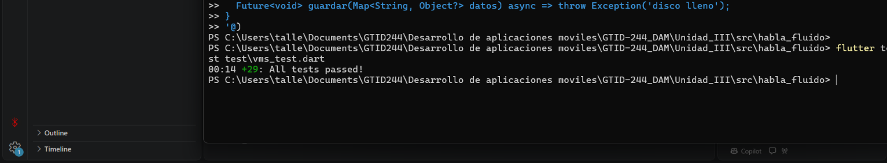

### Ronda 10: la app

Pantalla de inicio en Chrome, con nivel, racha y plan de hoy:

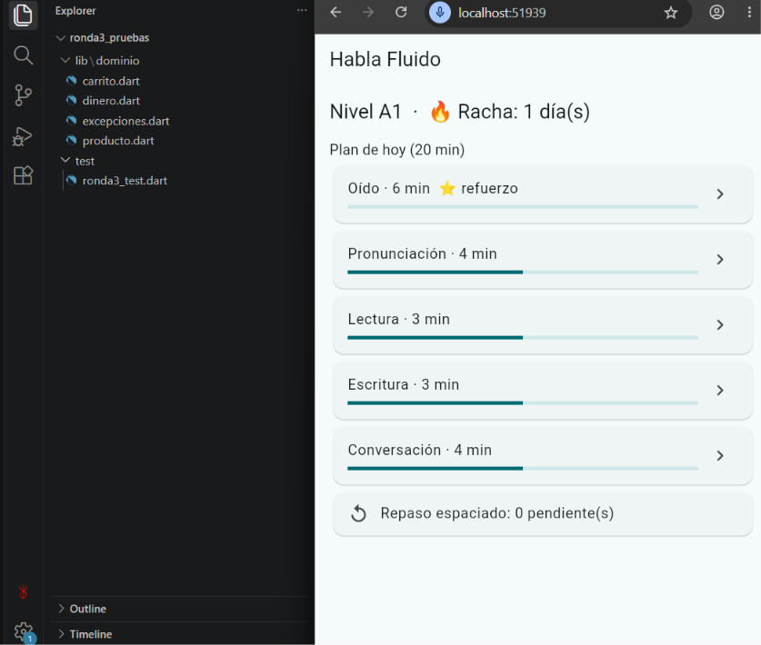

## Datos de prueba

- La pasarela de práctica no existe en esta app: el tutor es simulado por defecto.
- Las pruebas usan un reloj inyectado (`reloj: () => fecha`), así que no dependen del día en que se corran.

## Notas importantes

- **Voz:** `flutter_tts` y `speech_to_text` solo funcionan en el teléfono. En Chrome, la app usa la voz simulada.
- **Reconocimiento:** el audio se procesa con el servicio de voz del sistema (Google o Apple), que puede salir del teléfono. Indícalo en tu aviso de privacidad.
- **Claves:** la clave de la IA vive en el proxy, nunca en la app ni en el APK. Los valores de `--dart-define` quedan dentro de la app compilada, así que solo sirven para la URL y un token casual.
- **Propósito:** es un proyecto de práctica. Antes de usarlo con estudiantes reales, revisa la Ronda 11 del manual (evaluación del aprendizaje).
