# Lotería Push — Evidencia de TDD por rondas

Lotería Push es una app didáctica de **notificaciones push (Firebase Cloud Messaging)** en Flutter, con un cantor de Lotería que vive en un servidor Node. Cada carta que canta el servidor llega como push a los jugadores de la sala; si alguien está a una carta de ganar recibe un aviso personal, y el servidor valida quién gana. Se construyó con TDD siguiendo el *Manual paso a paso con TDD — Lotería Push* (Desarrollo Móvil Integral, UTNG).

Este documento reúne las capturas organizadas por ronda. Todas están en la carpeta [`capturas/`](capturas/).

> Principio del proyecto: **el push es un AVISO, el servidor es la VERDAD.** La app sigue funcionando sin permiso de notificaciones (consulta al servidor cada 5 s).

## Cómo leer las capturas

En cada ronda de lógica se siguió el ciclo de TDD:

1. 🔴 **Rojo:** se escribió primero el archivo de pruebas y se ejecutó (`npm test` en el servidor, `flutter test test\<archivo>` en la app); falla porque el código todavía no existe (`test failed`, `Method not found`, `isn't a type`).
2. 🟢 **Verde:** se escribió el código mínimo y se volvió a ejecutar hasta que todo pasó (`fail 0` en Node, `All tests passed!` en Flutter).

> **Nota sobre los contadores del servidor (rondas 2 a 5):** `npm test` ejecuta *todas* las pruebas de la carpeta `server/test`, así que el total es acumulado: 22 → 31 → 49 → 61. En cada captura roja, el único archivo que falla es el nuevo.

## Resumen

| Ronda | Tema | Archivo de pruebas | Resultado en verde |
|-------|------|--------------------|--------------------|
| 2 | El servidor: la baraja y las reglas de líneas | `baraja.test.js`, `lineas.test.js` | `pass 22` |
| 3 | Armar mensajes push correctos | `mensajes.test.js` | `pass 31` (acumulado) |
| 4 | La sala: reglas, autorización y trampas | `sala.test.js` | `pass 49` (acumulado) |
| 5 | El servidor HTTP y el envío seguro | `servidor.test.js` | `pass 61` (acumulado) |
| 6 | La app: parsear lo que llega y mantener la partida | `evento_lineas_test.dart`, `partida_test.dart` | `+17` y `+10` |
| 7 | Puertos, doble de pruebas y el controlador | `controlador_test.dart` | `+22` |
| 8 | El adaptador de Firebase | (`flutter analyze`) | 2 avisos `info` |
| 9 | Pantallas, ViewModels y el arranque | `pantalla_test.dart` | `+3` |
| 10 | Probar en dispositivos reales | (capturas de la app en el teléfono) | — |

Las rondas 0 (los diez mandamientos del push), 1 (preparar Firebase, Android e iOS), 11 (seguridad, privacidad y abuso) y 12 (tokens a escala y FID) son de teoría, configuración o diseño y no producen pruebas, por lo que no tienen capturas de rojo/verde.

## Estructura del proyecto

Carpeta `app/` en VS Code con el dominio separado de la infraestructura y la presentación (`lib/dominio`, `lib/infra`, `lib/presentacion`). Los archivos del dominio de las rondas 6 y 7 son `almacen`, `api_juego`, `cartas`, `controlador`, `evento`, `lineas`, `partida`, `puerto_push` y `sesion`.

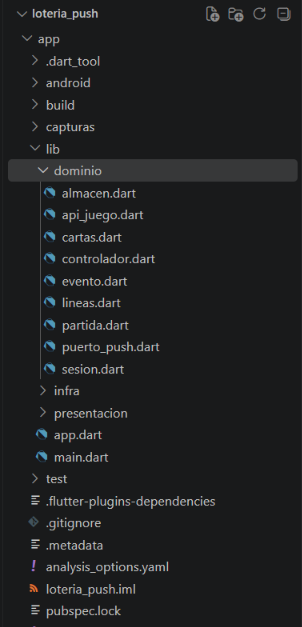

## Rondas de lógica del servidor (2 a 5)

### Ronda 2 — El servidor primero: la baraja y las reglas

Archivos de pruebas: `server/test/baraja.test.js` y `server/test/lineas.test.js`

🔴 **Rojo** — `baraja.test.js` y `lineas.test.js` fallan porque `baraja.js` y `lineas.js` todavía no existen (`capturas/r02_rojo.png`)

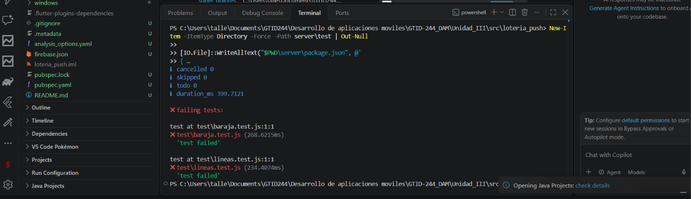

🟢 **Verde** — `tests 22 · pass 22 · fail 0` (`capturas/r02_verde.png`)

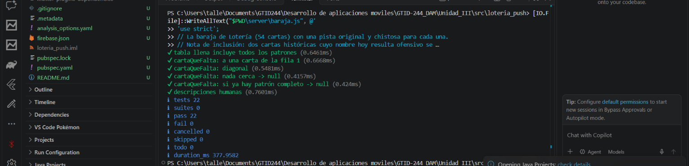

### Ronda 3 — Armar mensajes push correctos

Archivo de pruebas: `server/test/mensajes.test.js`

🔴 **Rojo** — `tests 23 · pass 22 · fail 1`: solo falla `mensajes.test.js` porque `mensajes.js` aún no existe (`capturas/r03_rojo.png`)

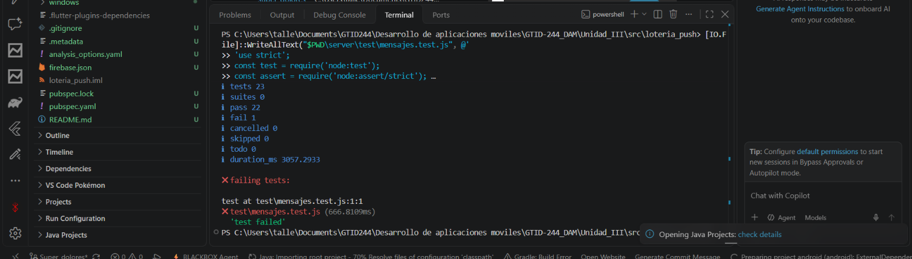

🟢 **Verde** — `tests 31 · pass 31 · fail 0`: colapso, canales, TTL, destino por token o fid y límite de 4 KB (`capturas/r03_verde.png`)

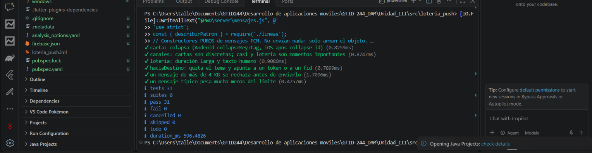

### Ronda 4 — La sala: reglas, autorización y trampas

Archivo de pruebas: `server/test/sala.test.js`

🔴 **Rojo** — `tests 32 · pass 31 · fail 1`: solo falla `sala.test.js` (`capturas/r04_rojo.png`)

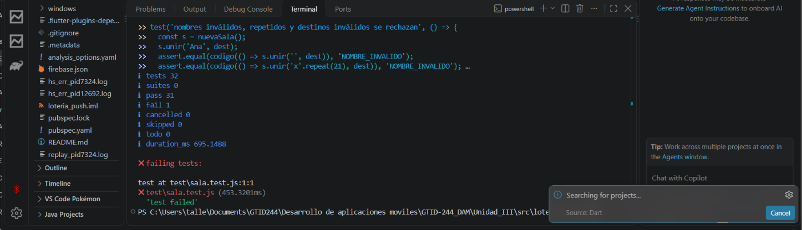

🟢 **Verde** — `tests 49 · pass 49 · fail 0`: aviso de "¡casi!" una sola vez, solo el cantor verifica, la clave del jugador protege el destino (`capturas/r04_verde.png`)

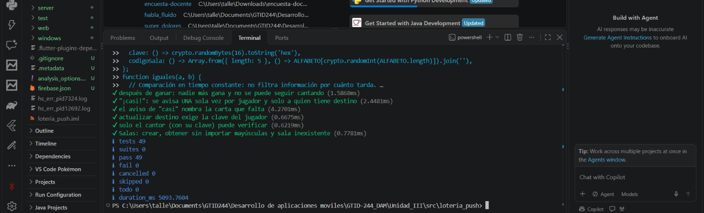

### Ronda 5 — El servidor HTTP y el envío seguro

Archivo de pruebas: `server/test/servidor.test.js` (levanta el servidor real y le habla por HTTP)

🔴 **Rojo** — `tests 50 · pass 49 · fail 1`: solo falla `servidor.test.js` (`capturas/r05_rojo.png`)

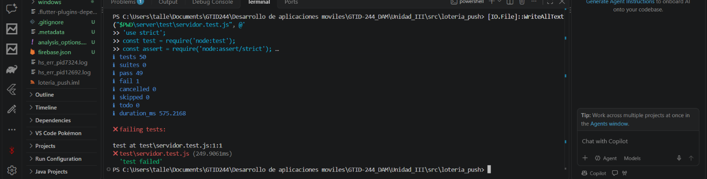

🟢 **Verde** — `tests 61 · pass 61 · fail 0`: el servidor valida la Lotería, protege los destinos y no filtra detalles de errores internos (`capturas/r05_verde.png`)

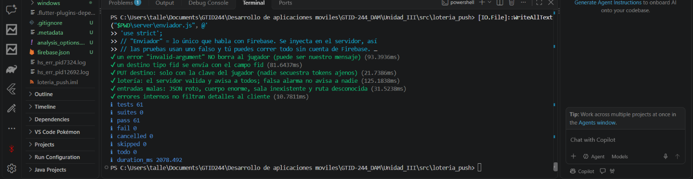

## Rondas de la app Flutter (6 a 9)

### Ronda 6 — La app: parsear lo que llega y mantener la partida

Archivos de pruebas: `test/evento_lineas_test.dart` y `test/partida_test.dart`

🔴 **Rojo** — `evento_lineas_test.dart` falla con `Method not found: 'describirPatron'` porque `evento.dart` aún no existe (`capturas/r06_rojo.png`)

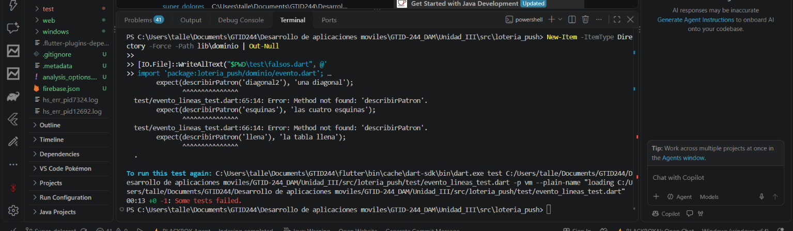

🟢 **Verde** — `partida_test.dart` con `+10: All tests passed!` y `evento_lineas_test.dart` con `+17: All tests passed!` (`capturas/r06_verde.png`)

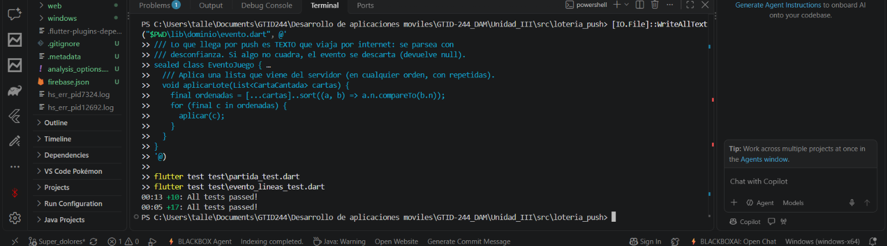

### Ronda 7 — Puertos, doble de pruebas y el controlador

Archivo de pruebas: `test/controlador_test.dart` (usa los dobles de `test/falsos.dart`)

🔴 **Rojo** — falla con `'MensajePush' isn't a type` y `'DestinoPush' isn't a type` porque `puerto_push.dart` y el controlador todavía no existen (`capturas/r07_rojo.png`)

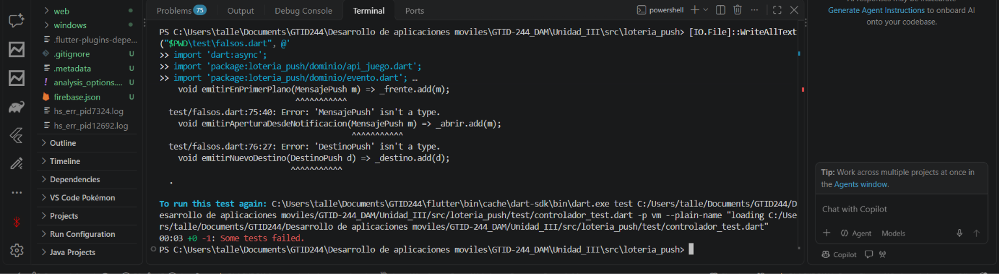

🟢 **Verde** — `+22: All tests passed!` (`capturas/r07_verde.png`)

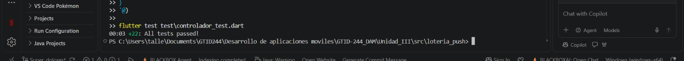

### Ronda 8 — El adaptador de Firebase: tres estados de la app

El único archivo que importa `firebase_messaging` es `lib/infra/puerto_fcm.dart`; toca el SDK y el dispositivo, así que esta ronda no tiene ciclo rojo/verde de pruebas. Se verificó con `flutter analyze lib`.

🔍 **Análisis estático** — 2 avisos de tipo `info` (no son errores): `getToken` y `onTokenRefresh` están marcados como obsoletos en favor de `register()` y `onRegistered`. Es la migración del token al FID que el manual explica en la Ronda 12; como el SDK vive aislado detrás de `PuertoPush`, migrarlo solo toca ese archivo (`capturas/r08_analyze.png`)

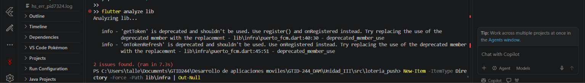

### Ronda 9 — Pantallas, ViewModels y el arranque

Archivo de pruebas: `test/pantalla_test.dart`

🔴 **Rojo** — falla con `Method not found: 'JuegoVm'` y `Method not found: 'PantallaJuego'` porque las pantallas todavía no existen (`capturas/r09_rojo.png`)

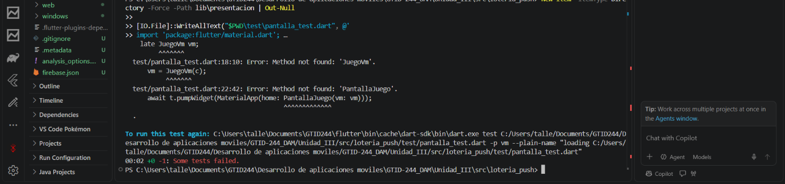

🟢 **Verde** — `+3: All tests passed!`. Se ejecutó `flutter analyze lib` junto con la prueba y siguen apareciendo los mismos 2 avisos `info` de la Ronda 8 (`capturas/r09_verde.png`)

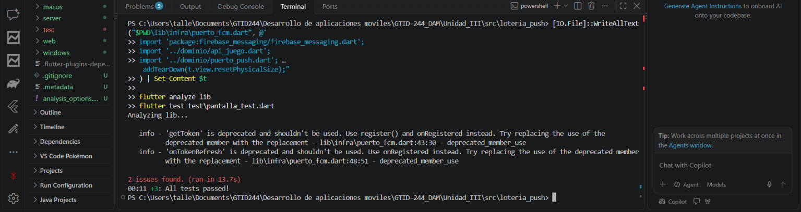

## Ronda 10 — Probar en dispositivos reales

La app corre en un teléfono Android real (versión *debug*, conectada al servidor del cantor). Estas capturas corresponden al recorrido guiado del manual.

**Inicio** — nombre del jugador, código de sala, botón "Unirme a la sala" y opción "Soy el cantor: crear una sala".

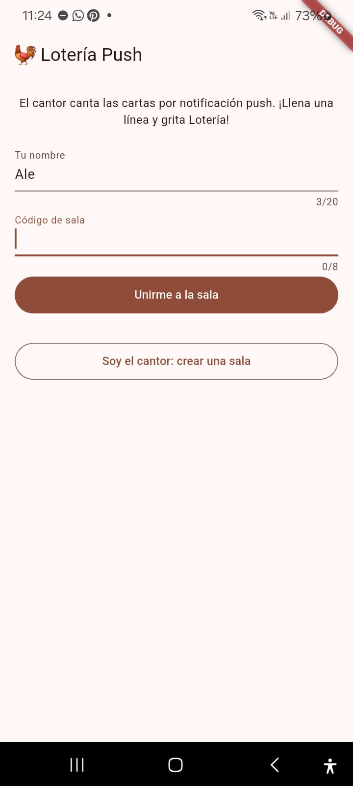

**Cantor: sala creada** — el cantor ve el código de la sala para compartirlo, el botón "Cantar la siguiente carta" y el interruptor de canto automático (apagado).

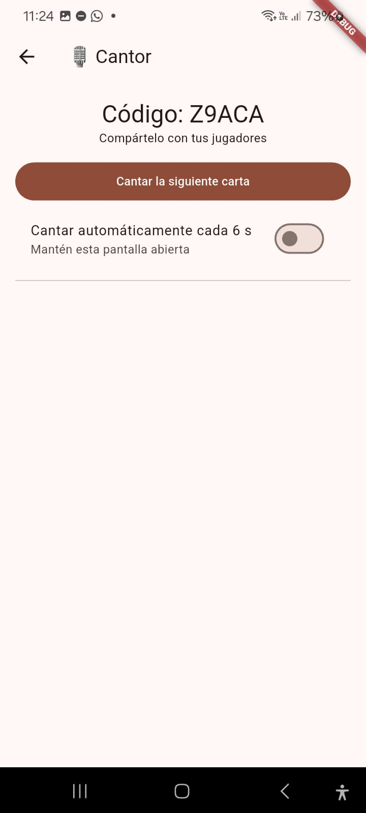

**Cantor cantando** — canto automático cada 6 s activado; la lista muestra las cartas cantadas (La Botella, El Gallo, La Rana, El Árbol). El aviso "Canta más despacio" corresponde al freno de 2 s del servidor contra abuso.

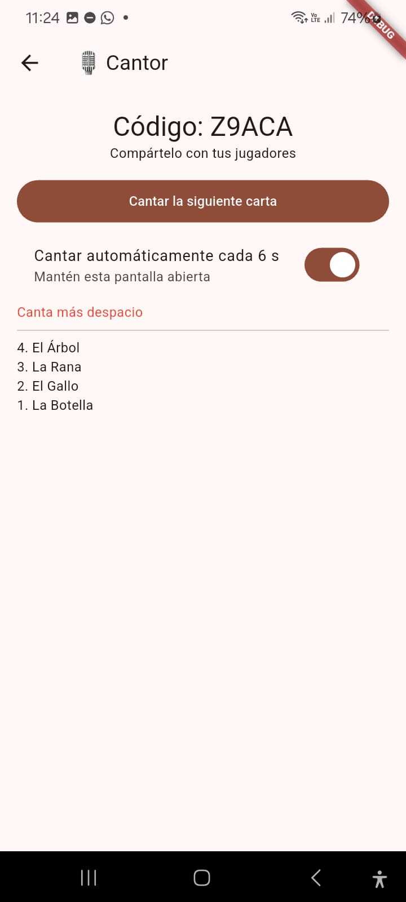

**Permiso en contexto** — al tocar "Unirme a la sala", primero aparece la explicación propia ("¿Quieres que el cantor te avise?") con la opción "Mejor no"; solo si acepta aparece el diálogo del sistema. Sin permiso, igual puede jugar.

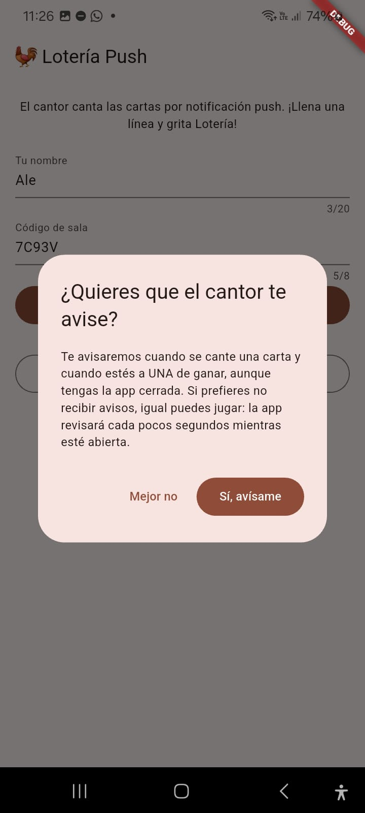

**Jugador en la sala** — tabla de 16 cartas, aviso "Esperando la primera carta..." y el botón ¡LOTERÍA! deshabilitado hasta completar una línea.

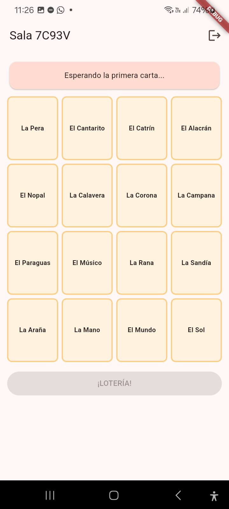

## Cómo ejecutar

Servidor (Node 20 o superior, sin dependencias para las pruebas):

```
cd server
npm test
npm start
```

App:

```
cd app
flutter pub get
flutter test
flutter run --dart-define=SERVIDOR=http://10.0.2.2:8080
```

En un teléfono real usa la IP de tu computadora en la misma red wifi en lugar de `10.0.2.2`.
