# Tienda Talavera Dolores

Tienda móvil de artesanías de Dolores Hidalgo, hecha con Flutter siguiendo TDD (primero la prueba en ROJO, después el código en VERDE). Incluye catálogo, carrito, cupones, checkout con tarjeta simulada, cuentas de usuario y perfil. La función "Ver en tu espacio" con realidad aumentada queda pendiente.

## Requisitos

- Flutter estable (`flutter --version`)
- Windows con PowerShell, o Mac/Linux
- Chrome o Edge para la versión web
- Un teléfono Android para probar la app en dispositivo

## Ejecutar el proyecto

```powershell
cd tienda_talavera
flutter pub get
flutter run -d chrome
```

Las pruebas se ejecutan una por una, por ronda (ver la sección de pruebas).

## Estructura

```
lib/
├── dominio/        Reglas del negocio: dinero, productos, carrito, tarjeta, validadores, checkout
├── datos/          Pasarela simulada, autenticación simulada, catálogo y almacenes en memoria
└── presentacion/
    ├── vm/         ViewModels (lógica de cada pantalla)
    └── pantallas/  Interfaz: catálogo, detalle, carrito, checkout, perfil
test/               Pruebas por ronda
docs/capturas/      Evidencias de pruebas y de la app
```

El dominio no depende de Flutter, así que sus pruebas corren en consola, sin emulador.

## Rondas

| Ronda | Tema                               | Estado                                              |
|-------|------------------------------------|-----------------------------------------------------|
| 1     | Preparar el proyecto               | Lista                                               |
| 2     | Dinero y producto                  | Lista (pruebas en verde)                            |
| 3     | Excepciones y carrito              | Lista (pruebas en verde)                            |
| 4     | Validaciones, dirección y usuario  | Código listo, pruebas por confirmar                 |
| 5     | La tarjeta: Luhn, marcas y PCI     | Código listo, pruebas por confirmar                 |
| 6     | Contratos, pasarela e idempotencia | Pasarela lista (pruebas en verde)                   |
| 7     | Checkout y revalidación de precios | Funciona en la app, pruebas por confirmar           |
| 8     | Cuentas y perfil de usuario        | Funciona en la app (login, bloqueo, registro)       |
| 9     | ViewModels                         | Por confirmar sus pruebas                           |
| 10    | Las pantallas                      | Lista (catálogo, carrito, checkout, perfil)         |
| 11    | "Ver en tu espacio" (RA)           | Pendiente                                           |
| 12    | De la simulación a producción      | Pendiente                                           |

## Pruebas por ronda

Ejecuta cada prueba por separado. Todas deben terminar con `All tests passed!`.

Ronda 2 y 3 (dinero, producto y carrito):

```powershell
flutter test test\ronda3_test.dart --plain-name 'formatea pesos'
flutter test test\ronda3_test.dart --plain-name 'IVA incluido de 116.00 es 16.00'
flutter test test\ronda3_test.dart --plain-name 'porcentaje redondea al centavo'
flutter test test\ronda3_test.dart --plain-name 'suma subtotal'
flutter test test\ronda3_test.dart --plain-name 'rechaza más que las existencias y queda intacto'
flutter test test\ronda3_test.dart --plain-name 'límite de 10 por producto'
flutter test test\ronda3_test.dart --plain-name 'cupón DOLORES10 descuenta 10%'
```

Ronda 4 (validadores):

```powershell
flutter test test\ronda4_test.dart --plain-name 'correo'
flutter test test\ronda4_test.dart --plain-name 'password'
flutter test test\ronda4_test.dart --plain-name 'código postal y teléfono'
```

Ronda 5 (tarjeta):

```powershell
flutter test test\ronda5_test.dart --plain-name 'Luhn válidas'
flutter test test\ronda5_test.dart --plain-name 'Luhn inválida'
flutter test test\ronda5_test.dart --plain-name 'acepta espacios'
flutter test test\ronda5_test.dart --plain-name 'marcas'
flutter test test\ronda5_test.dart --plain-name 'vigencia hasta el último día del mes'
flutter test test\ronda5_test.dart --plain-name 'CVV de 4 dígitos solo en Amex'
flutter test test\ronda5_test.dart --plain-name 'toString nunca muestra el número completo'
```

Ronda 6 (pasarela):

```powershell
flutter test test\pasarela_test.dart --plain-name 'aprueba tarjeta de prueba'
flutter test test\pasarela_test.dart --plain-name 'rechaza tarjeta 0002'
flutter test test\pasarela_test.dart --plain-name 'IDEMPOTENCIA: misma clave dos veces cobra una sola vez'
flutter test test\pasarela_test.dart --plain-name 'claves distintas sí cobran por separado'
```

Análisis del dominio:

```powershell
flutter analyze lib
```

## Capturas

### Terminal: creación del proyecto y pruebas

Creación del proyecto y dependencias:

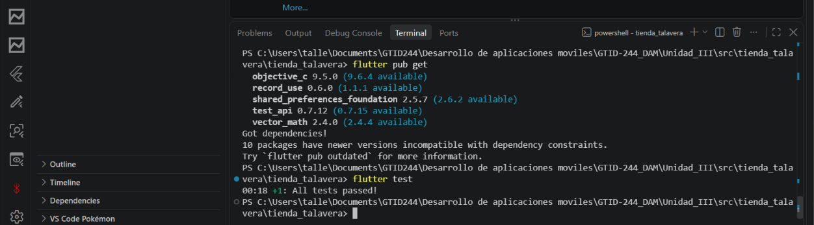
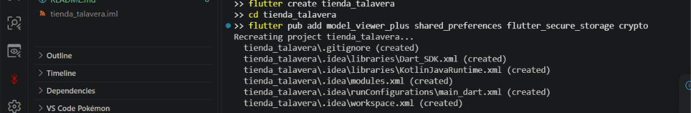
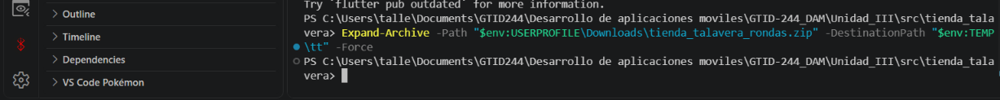
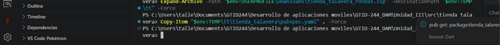

Pruebas de dinero:

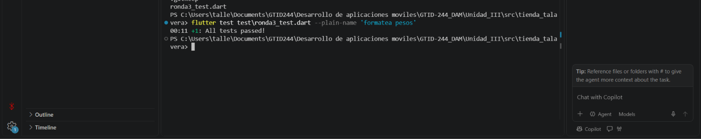
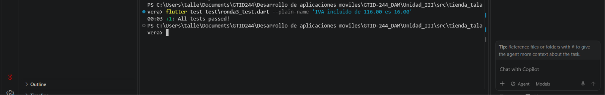

Pruebas de carrito:

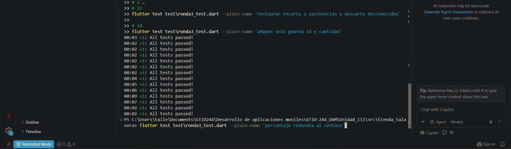

Pruebas de pasarela:

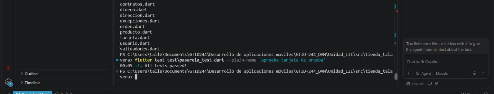
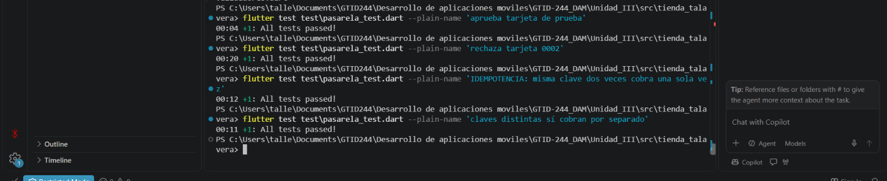

Análisis del dominio sin errores:

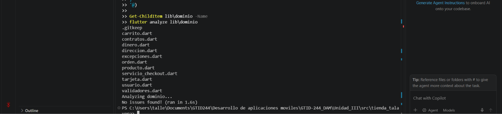

### App: perfil, cuenta y seguridad

Inicio de sesión:

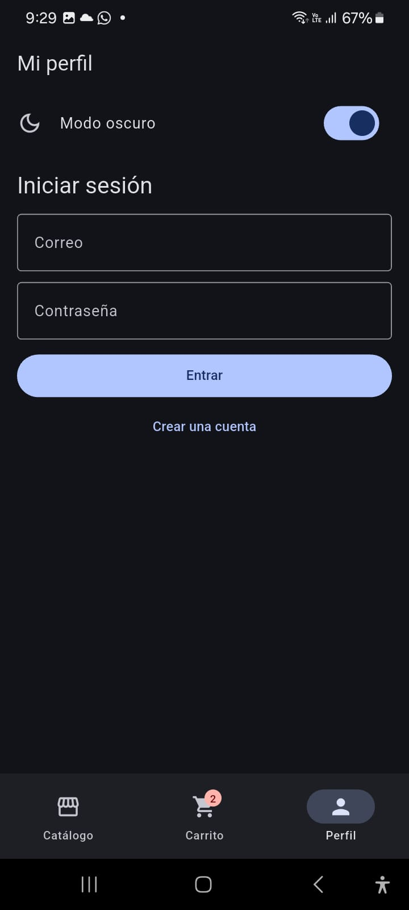
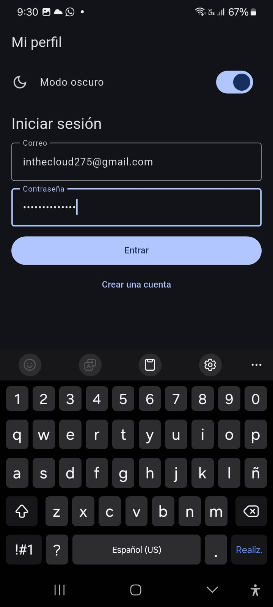
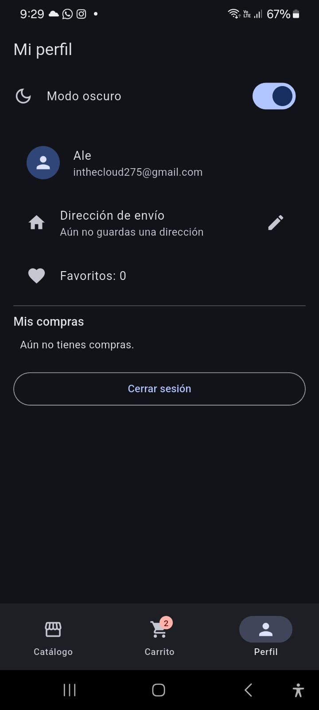
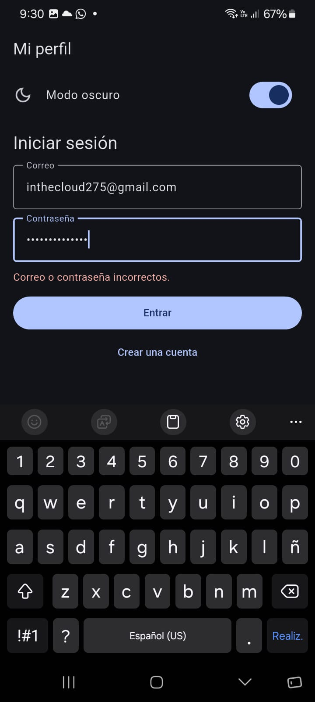
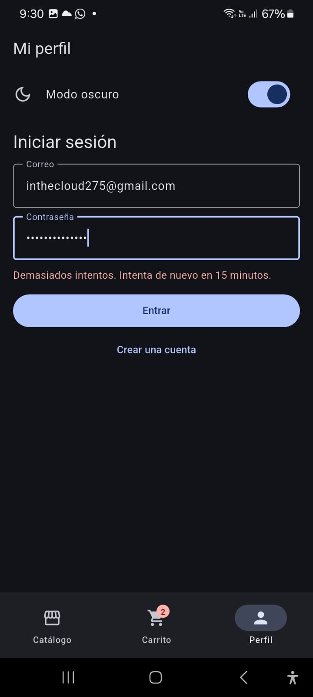
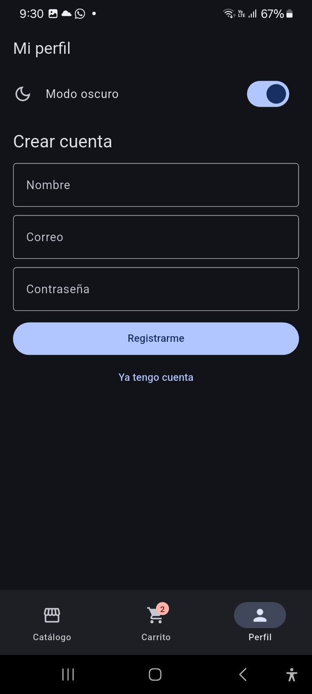
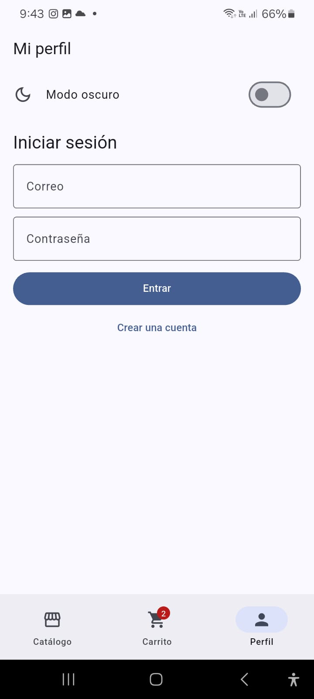

### App: compra

Catálogo y carrito:

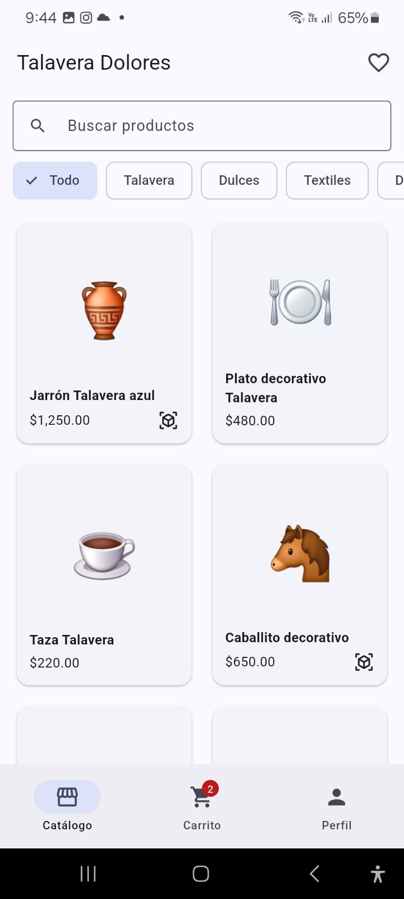
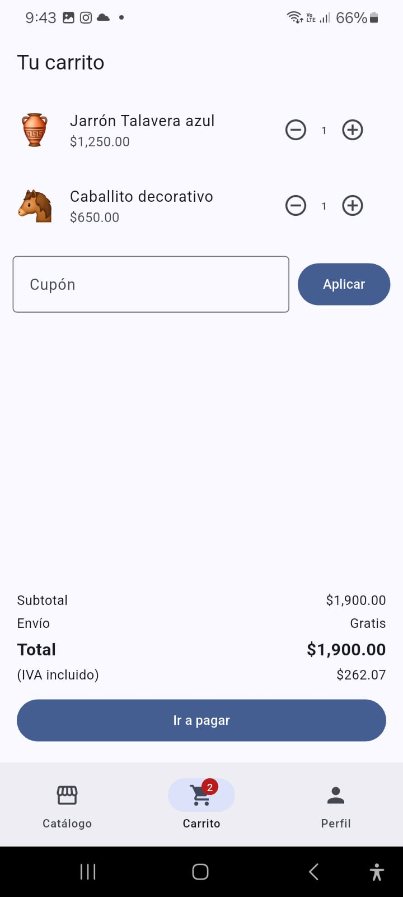

Checkout:

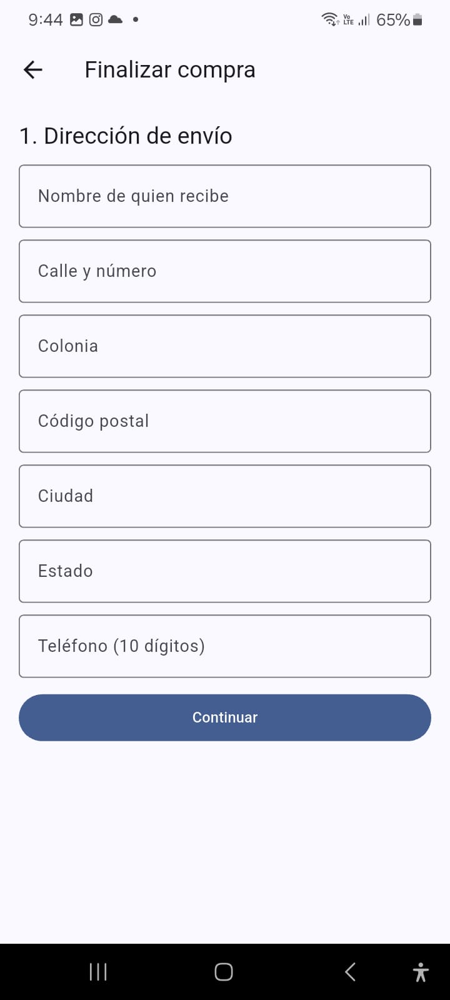
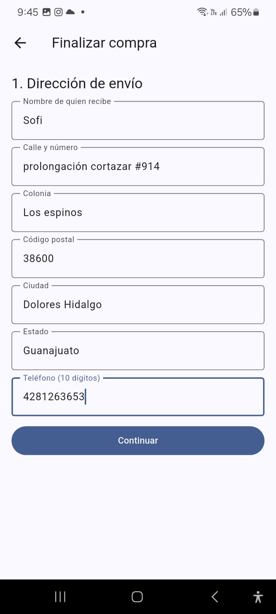
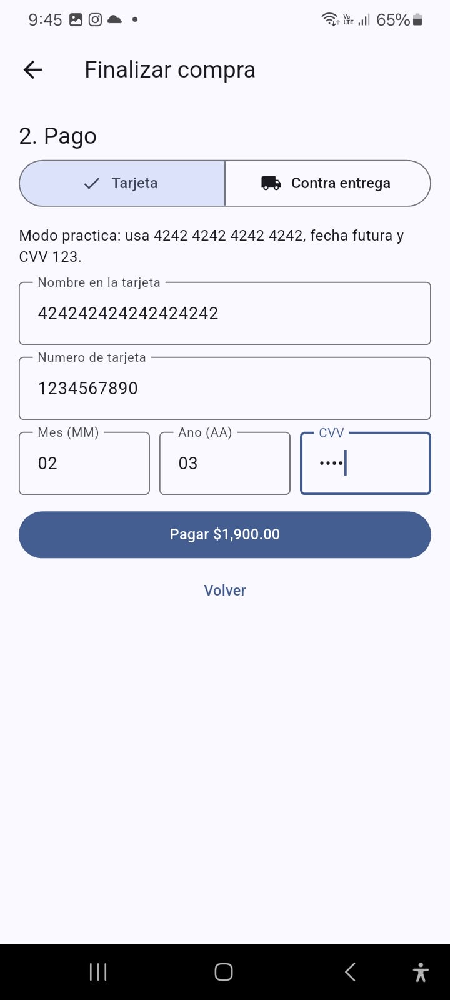
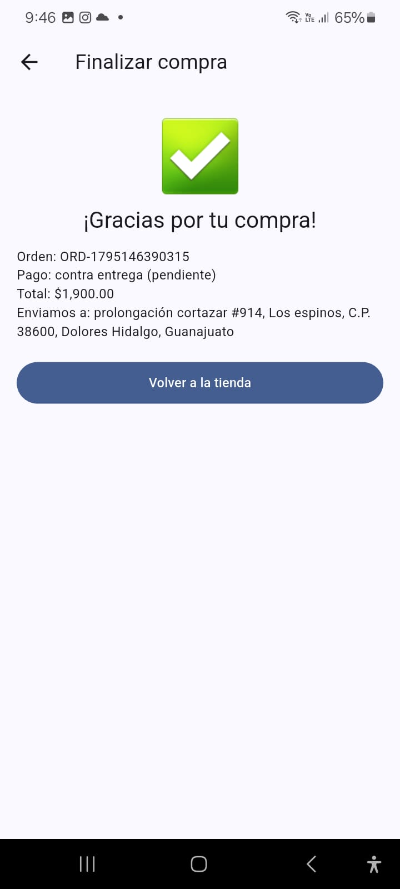

Reseña de producto:

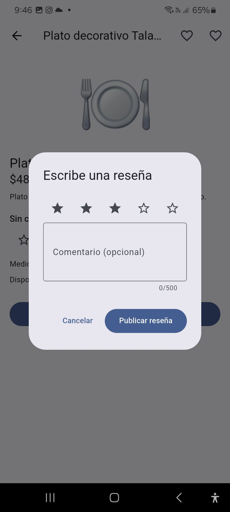

Historial en el perfil:

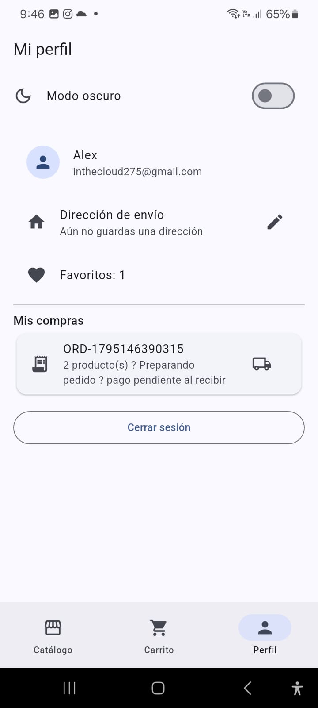
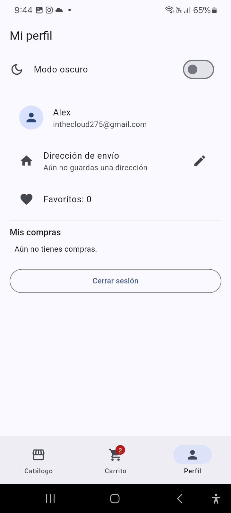

## Datos de prueba

- Tarjeta aprobada: `4242 4242 4242 4242`, fecha futura, CVV `123`.
- Tarjeta rechazada: `4000 0000 0000 0002`. No descuenta inventario.
- Tarjeta con fondos insuficientes: `4000 0000 0000 9995`.
- Cupón: `DOLORES10` (10% de descuento).
- El envío es gratis desde $800.00. Si no, cuesta $99.00.

## Seguridad

- El dinero se maneja en centavos enteros, nunca con `double`.
- La app no guarda el número completo de la tarjeta ni el CVV. Solo los últimos 4 dígitos en la orden.
- Las contraseñas no se guardan: se guarda un hash con sal.
- Después de 5 intentos fallidos, la cuenta se bloquea 15 minutos.
- El token de sesión va en almacenamiento seguro (Keychain / Keystore).
- Los modelos 3D solo se aceptan desde `assets/` o por `https://`.

## Notas

- La pasarela de pagos es simulada. No procesa dinero real.
- Este proyecto es de práctica. Antes de cobrar dinero real, sigue la Ronda 12 del manual.
