# Super Dolores — Evidencia de TDD por rondas

Super Dolores es una SuperApp didáctica (mensajería, monedero, comercio local, transporte, mini-apps, lealtad y analítica de retención) construida con TDD en Flutter/Dart, siguiendo el *Manual paso a paso con TDD — Super Dolores* (Desarrollo Móvil Integral, UTNG).

Este documento reúne las capturas organizadas por ronda. Todas están en la carpeta [`capturas/`](capturas/).

> La app es una **simulación didáctica**: el monedero es de juguete y no mueve dinero real.

## Cómo leer las capturas

En cada ronda de lógica se siguió el ciclo de TDD:

1. 🔴 **Rojo:** se escribió primero el archivo de pruebas y se ejecutó `flutter test test\<archivo>`; falla porque el código todavía no existe (errores como `Undefined name`, `Method not found` o `isn't defined`).
2. 🟢 **Verde:** se escribió el código mínimo y se volvió a ejecutar hasta ver `All tests passed!`. El contador (`+N`) es el número de pruebas de ese archivo.

## Resumen

| Ronda | Tema | Archivo de pruebas | Resultado en verde |
|-------|------|--------------------|--------------------|
| 2 | Dinero, fechas y errores | `dinero_test.dart` | `+4` |
| 3 | El monedero: contabilidad, no un número | `monedero_test.dart` | `+10` |
| 4 | Eventos: el sistema nervioso | `eventos_test.dart` | `+4` |
| 5 | Mensajería con dinero dentro del chat | `mensajeria_test.dart` | `+6` |
| 6 | Comercio local con comisión | `comercio_test.dart` | `+6` |
| 7 | Transporte: distancia, tarifa y máquina de estados | `transporte_test.dart` | `+13` |
| 8 | Mini-apps, permisos y la plataforma | `mini_app_test.dart` | `+6` |
| 9 | Lealtad: el motor de retención | `lealtad_test.dart` | `+16` |
| 10 | Analítica: medir la retención sin engañarse | `analitica_test.dart` | `+7` |
| 11 | Notificaciones éticas y sugerencias | `notificaciones_test.dart` | `+8` |
| 12 | ViewModels | `servicios_test.dart` | `+21` |
| 12 | ViewModels | `vms_test.dart` | `+22` |
| 13 | Pantallas y la concha de la app | (capturas de la app en ejecución) | — |

Las rondas 0 y 1 (ideas de diseño y preparación del proyecto) y las rondas 14 y 15 (pruebas con personas, y aspectos legales y de escalamiento) no producen código con pruebas, por lo que no tienen capturas de rojo/verde.

## Rondas de lógica (2 a 11)

### Ronda 2 — Dinero, fechas y errores

Archivo de pruebas: `test/dinero_test.dart`

🔴 **Rojo** — la prueba falla porque el código aún no existe (`capturas/r02_rojo.png`)

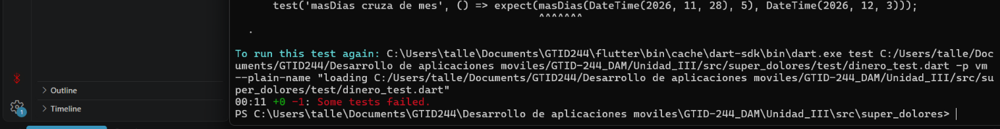

🟢 **Verde** — `+4: All tests passed!` (`capturas/r02_verde.png`)

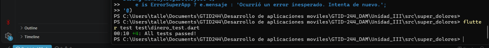

### Ronda 3 — El monedero: contabilidad, no un número

Archivo de pruebas: `test/monedero_test.dart`

<!-- Falta la captura roja: capturas/r03_rojo.png -->

🟢 **Verde** — `+10: All tests passed!` (`capturas/r03_verde.png`)

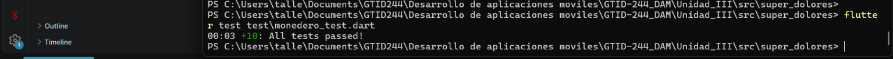

### Ronda 4 — Eventos: el sistema nervioso

Archivo de pruebas: `test/eventos_test.dart`

🔴 **Rojo** — la prueba falla porque el código aún no existe (`capturas/r04_rojo.png`)

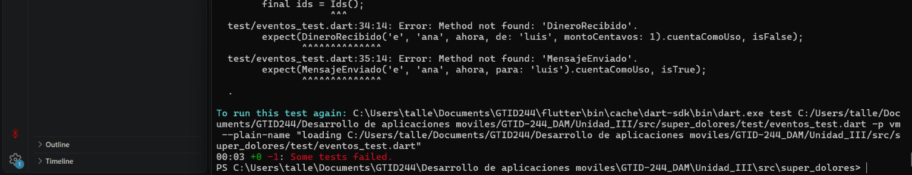

🟢 **Verde** — `+4: All tests passed!` (`capturas/r04_verde.png`)

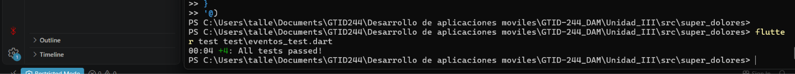

### Ronda 5 — Mensajería con dinero dentro del chat

Archivo de pruebas: `test/mensajeria_test.dart`

🔴 **Rojo** — la prueba falla porque el código aún no existe (`capturas/r05_rojo.png`)

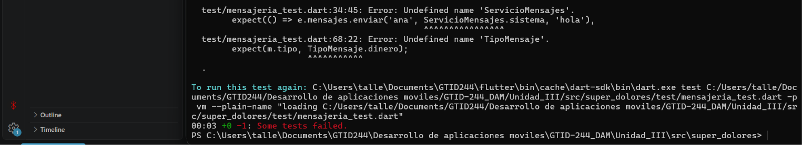

🟢 **Verde** — `+6: All tests passed!` (`capturas/r05_verde.png`)

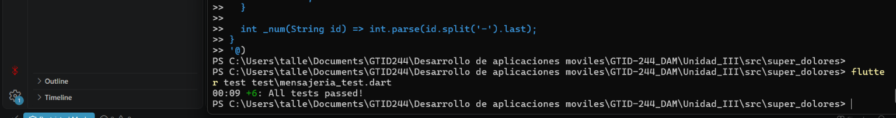

### Ronda 6 — Comercio local con comisión

Archivo de pruebas: `test/comercio_test.dart`

🔴 **Rojo** — la prueba falla porque el código aún no existe (`capturas/r06_rojo.png`)

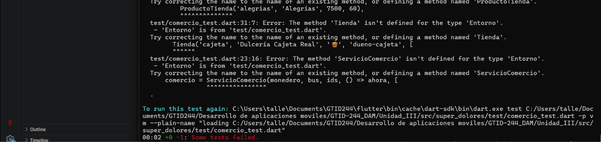

🟢 **Verde** — `+6: All tests passed!` (`capturas/r06_verde.png`)

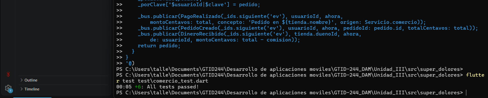

### Ronda 7 — Transporte: distancia, tarifa y máquina de estados

Archivo de pruebas: `test/transporte_test.dart`

🔴 **Rojo** — la prueba falla porque el código aún no existe (`capturas/r07_rojo.png`)

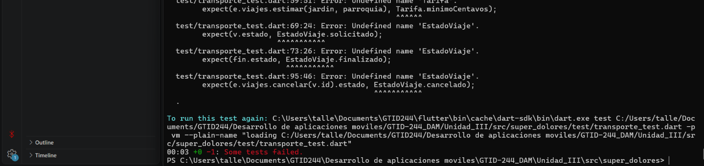

🟢 **Verde** — `+13: All tests passed!` (`capturas/r07_verde.png`)

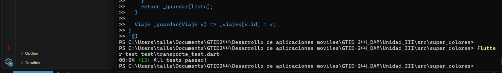

### Ronda 8 — Mini-apps, permisos y la plataforma

Archivo de pruebas: `test/mini_app_test.dart`

🔴 **Rojo** — la prueba falla porque el código aún no existe (`capturas/r08_rojo.png`)

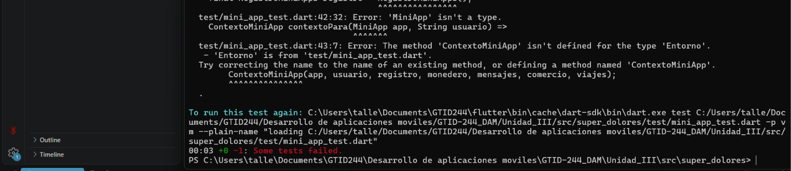

🟢 **Verde** — `+6: All tests passed!` (`capturas/r08_verde.png`)

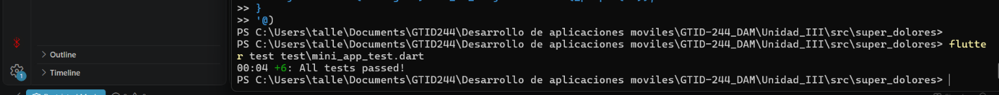

### Ronda 9 — Lealtad: el motor de retención

Archivo de pruebas: `test/lealtad_test.dart`

🔴 **Rojo** — la prueba falla porque el código aún no existe (`capturas/r09_rojo.png`)

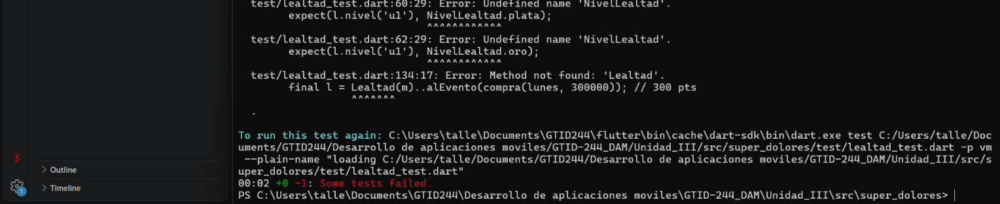

🟢 **Verde** — `+16: All tests passed!` (`capturas/r09_verde.png`)

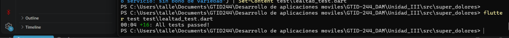

### Ronda 10 — Analítica: medir la retención sin engañarse

Archivo de pruebas: `test/analitica_test.dart`

🔴 **Rojo** — la prueba falla porque el código aún no existe (`capturas/r10_rojo.png`)

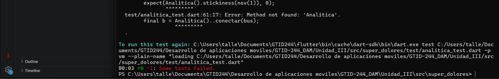

🟢 **Verde** — `+7: All tests passed!` (`capturas/r10_verde.png`)

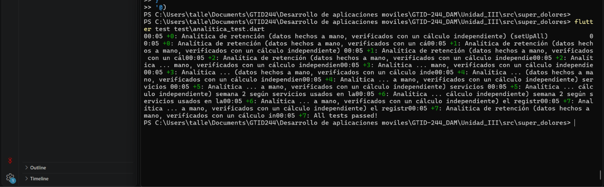

### Ronda 11 — Notificaciones éticas y sugerencias

Archivo de pruebas: `test/notificaciones_test.dart`

🔴 **Rojo** — la prueba falla porque el código aún no existe (`capturas/r11_rojo.png`)

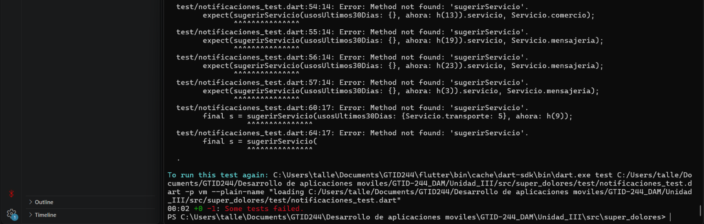

🟢 **Verde** — `+8: All tests passed!` (`capturas/r11_verde.png`)

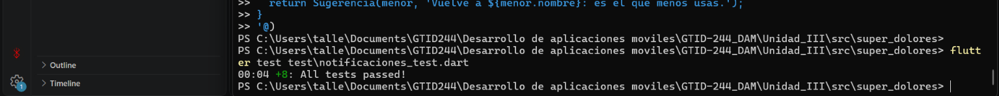

### Ronda 12 — ViewModels

Esta ronda tiene dos ciclos de TDD.

**Ciclo 1: `servicios_test.dart`** (la plataforma con todos sus servicios integrados)

🔴 **Rojo** (`capturas/r12_servicios_rojo.png`)

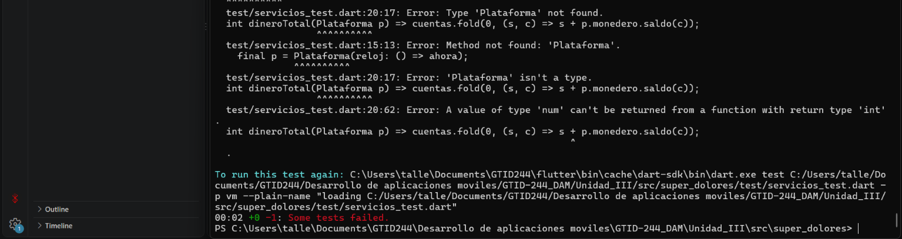

🟢 **Verde** — `+21: All tests passed!` (`capturas/r12_servicios_verde.png`)

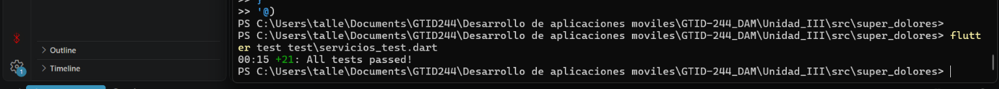

**Ciclo 2: `vms_test.dart`** (los ViewModels de cada pantalla)

🔴 **Rojo** (`capturas/r12_vms_rojo.png`)

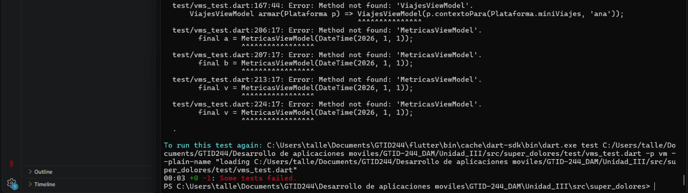

🟢 **Verde** — `+22: All tests passed!` (`capturas/r12_vms_verde.png`)

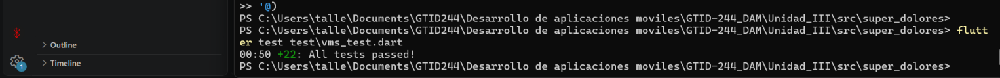

### Ronda 13 — Las pantallas y la concha de la SuperApp

La interfaz no reimplementa reglas de negocio: solo dibuja el estado de los ViewModels. La "concha" (`main.dart`) muestra la barra de navegación con las mini-apps activas.

**Inicio** — saldo de práctica, puntos de lealtad con nivel y racha, sugerencia "Para ti", acceso a los servicios, tablero de retención, mini-app de un tercero y simulación del kill switch.

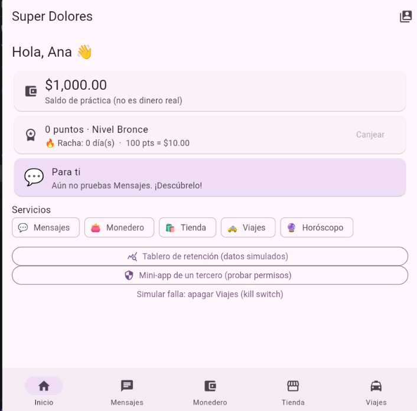

**Mensajes** — chat con Luis; el botón `$` envía dinero sin salir de la conversación.

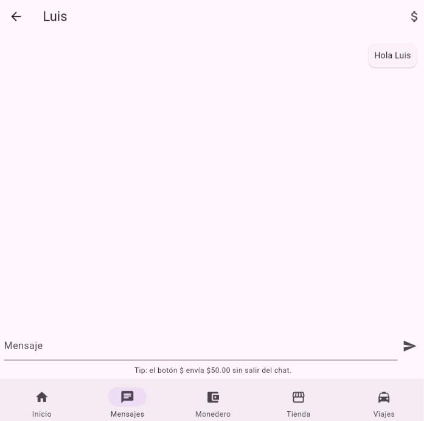

**Monedero** — saldo, envío a otra persona y libro de movimientos.

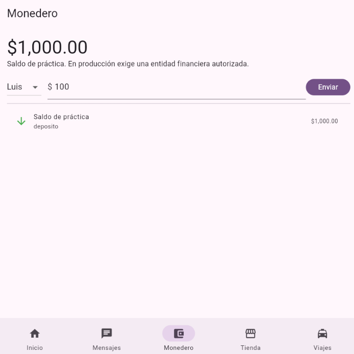

**Tienda** — comercio local (Talavera del Centro) con productos, existencias y pago con monedero.

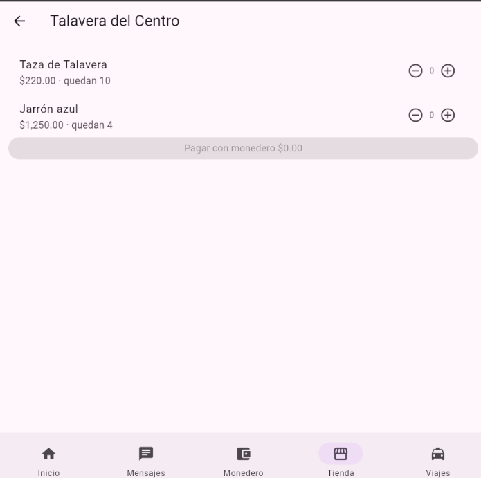

**Viajes** — origen, destino, distancia y tarifa estimada.

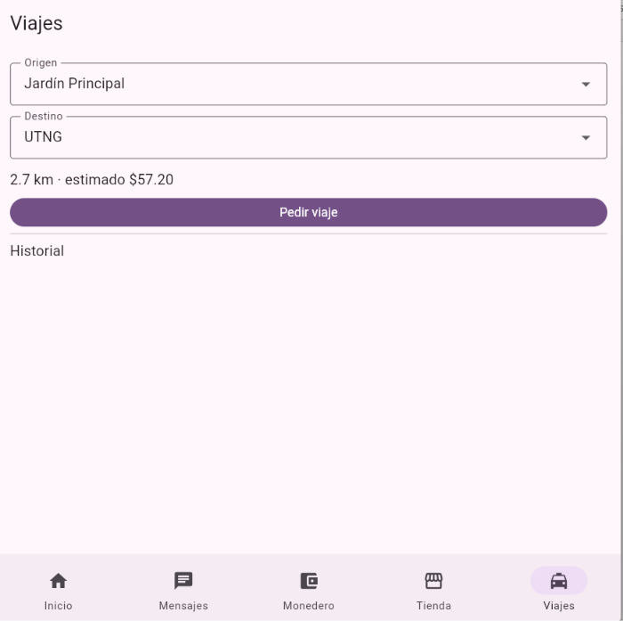

**Tablero de retención** — DAU, WAU, MAU, stickiness, retención D1/D7 y servicios por usuario, con datos simulados y la advertencia de que es una correlación y no una causa.

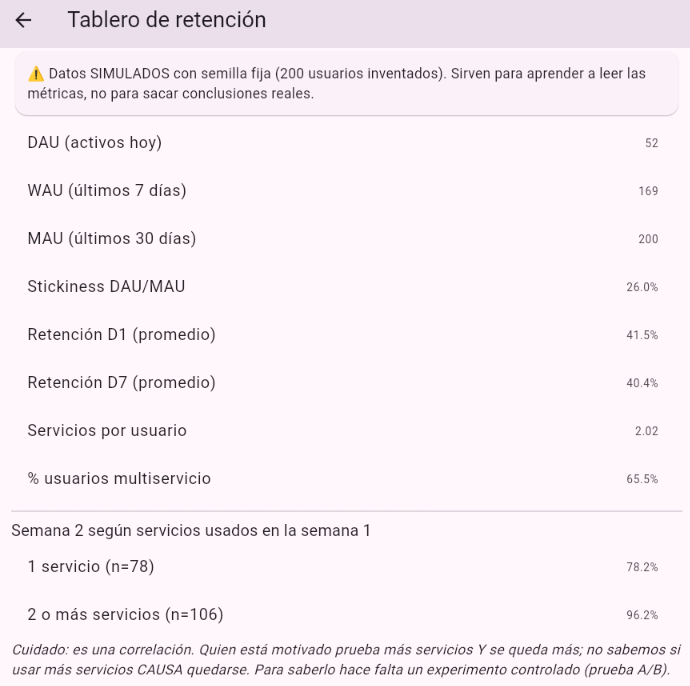

## Cómo ejecutar

```
flutter pub get
flutter test
flutter run
```
